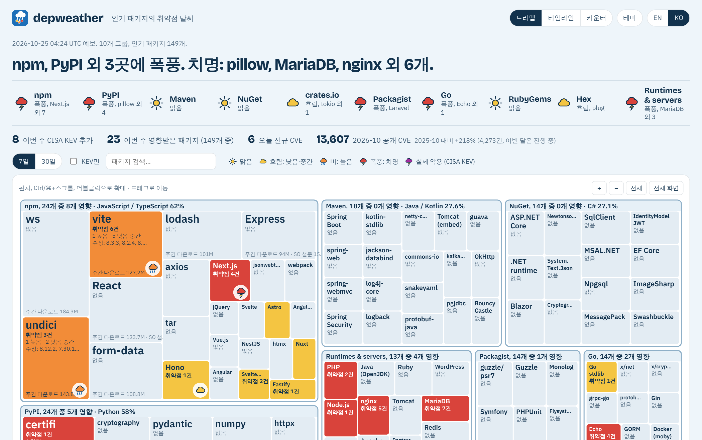

<p align="center"></p>

<h1 align="center">depweather</h1>

<p align="center">
  인기 패키지의 취약점 날씨.<br>
  <a href="https://depweather.com/?lang=ko"><b>depweather.com</b></a> · 하루 두 번 갱신<br><br>
  <a href="README.md">English</a> | <b>한국어</b>
</p>

<p align="center">
  <a href="https://depweather.com/?lang=ko"></a>
</p>

depweather는 매일 아침 한 가지 질문에 답합니다. **내가 쓰고 있을 법한 인기 패키지에
이번 주 심각한 취약점이 나왔나?** 일기예보처럼 읽혀서 몇 초면 알 수 있습니다.

## 화면에서 보는 것

- **예보 문장.** 데이터로 만듭니다. 예: *"npm, PyPI 외 3곳에 폭풍. 치명: pillow,
  MariaDB, nginx 외 6개."*
- **인기 패키지 149개 지도.** npm, PyPI, Maven, NuGet, crates.io, Packagist, Go,
  RubyGems, Hex와 PHP·Node.js·nginx 같은 런타임·서버까지 10개 그룹입니다. 다운로드가
  많을수록 타일이 크고, 확대하면 자세한 정보가 나옵니다.
- **패키지별 30일 타임라인.** 취약점마다 수정된 버전을 함께 보여줍니다.
- 영어와 한국어, 라이트와 다크 모드를 지원하고 휴대폰에서도 잘 보입니다.

| 날씨 | 뜻 |
|---|---|
| ☀️ 맑음 | 새 권고 없음 |
| ☁️ 흐림 | 낮음 또는 중간 |
| 🌧️ 비 | 높음 |
| ⛈️ 폭풍 | 치명 |
| 마젠타 폭풍 | 실제 악용 중(CISA KEV 목록) |

## 왜 만들었나

1년 사이 CVE 공개 건수가 약 2.5배로 늘었고, CVSS 점수만으로는 무엇부터 봐야 할지
알기 어려워졌습니다. depweather는 CVE 번호가 아니라 패키지를 기준으로 보여주고,
실제로 악용되고 있는 취약점을 따로 표시합니다.

내 코드를 스캔하지는 않습니다. 그건 Dependabot, `npm audit`, `pip-audit`,
`govulncheck`, `osv-scanner`를 쓰세요.

## 작동 방식

GitHub Actions 작업이 하루에 두 번 돕니다. [OSV](https://osv.dev)에서 권고를,
[CISA KEV](https://www.cisa.gov/known-exploited-vulnerabilities-catalog)에서 실제 악용
여부를, [FIRST EPSS](https://www.first.org/epss/)에서 악용 확률을,
[NVD](https://nvd.nist.gov)에서 CVE 건수를 모아 JSON 파일 하나로 만듭니다. HTML 한
장이 이를 그립니다. 서버와 로그인이 없고, 방문 통계는 Google Analytics로 봅니다.

색, 심각도 규칙, 패키지 선정 기준, 데이터 라이선스 같은 자세한 내용:
**[docs/how-it-works.ko.md](docs/how-it-works.ko.md)**

## 원하는 패키지가 없나요?

목록은 [`collect/stacks.yml`](collect/stacks.yml)에 있습니다. Stack Overflow 2026
설문과 레지스트리 다운로드 순위로 고른 널리 쓰이는 패키지만 담습니다. 추가 제안은
이슈나 풀 리퀘스트로 환영합니다.

## 직접 실행하기

```sh
pip install -r collect/requirements.txt
python collect/collect.py      # data/latest.json 생성(약 5분)
python -m http.server          # http://localhost:8000 열기
```

## 출처와 라이선스

데이터: OSV.dev(GitHub Advisory Database CC-BY 4.0, Bitnami Vulnerability Database
Apache-2.0 포함), CISA KEV, FIRST EPSS, NVD.
This product uses the NVD API but is not endorsed or certified by the NVD.

코드: [MIT](LICENSE).
