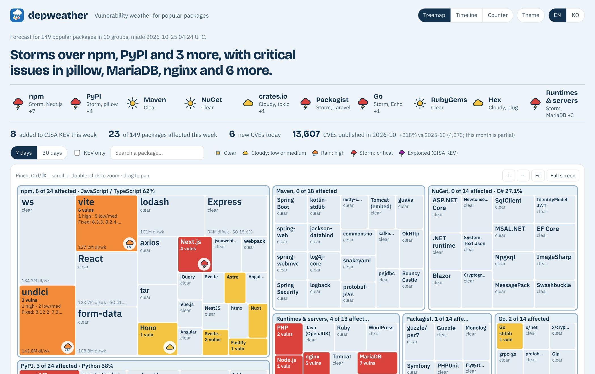

<p align="center"></p>

<h1 align="center">depweather</h1>

<p align="center">
  Vulnerability weather for popular packages.<br>
  <a href="https://depweather.com"><b>depweather.com</b></a> · updated twice a day<br><br>
  <b>English</b> | <a href="README.ko.md">한국어</a>
</p>

<p align="center">
  <a href="https://depweather.com"></a>
</p>

Every morning, depweather answers one question: **did any popular package I
probably depend on get a serious vulnerability this week?** It reads like a
weather report, so you can tell in a few seconds.

## What you see

- **A forecast** written from the data, like *"Storms over npm, PyPI and 3 more,
  with critical issues in pillow, MariaDB, nginx and 6 more."*
- **A map of 149 popular packages** in 10 groups: npm, PyPI, Maven, NuGet,
  crates.io, Packagist, Go, RubyGems, Hex, and runtimes & servers such as PHP,
  Node.js and nginx. Bigger tile, more downloads. Zoom in for details.
- **A 30-day timeline** for any package, with the versions that fix each issue.
- **A page per package** at `/pkg/npm/next/` (a Maven `:` is `~`), with severity,
  fixed versions, KEV and EPSS. Korean: `?lang=ko`.
- **A longer trend** on that page, and for each ecosystem on the Counter
  view: 3 months, 6 months or 1 year of severity-stacked bars, with CISA KEV
  marked on its own.
- **A README badge** at `/badge/npm/lodash.svg` (Korean: `.ko.svg`). Gray is a
  clear week, magenta is KEV. The package page has Markdown and HTML to copy.
- **My stack.** Paste `package.json`, `requirements.txt`, or another manifest
  to show only those packages. It is parsed in the browser; nothing is uploaded.
- English and Korean, light and dark, and it works on a phone.

| Weather | Means |
|---|---|
| ☀️ Clear | No new advisory |
| ☁️ Cloudy | Low or medium |
| 🌧️ Rain | High |
| ⛈️ Storm | Critical |
| Magenta storm | Actively exploited (on the CISA KEV list) |

## Why

The number of published CVEs grew about 2.5x in a year, and CVSS scores alone
no longer tell you what to look at first. depweather shows packages rather
than CVE IDs, and marks what is known to be exploited.

It does not scan your code. For that, use Dependabot, `npm audit`,
`pip-audit`, `govulncheck` or `osv-scanner`.

## How it works

A GitHub Actions job runs twice a day. It pulls advisories from
[OSV](https://osv.dev), exploited flags from
[CISA KEV](https://www.cisa.gov/known-exploited-vulnerabilities-catalog),
exploit probabilities from [FIRST EPSS](https://www.first.org/epss/) and CVE
counts from [NVD](https://nvd.nist.gov), and writes them into one JSON file.
A single HTML page draws it. No server and no login; Google Analytics counts visits.

Details (colors, severity rules, how packages are picked, data licenses):
**[docs/how-it-works.md](docs/how-it-works.md)**

## Alerts

No account. Subscribe to the [Atom feed](https://depweather.com/feed.xml)
(one package: `/feed/npm/next.xml`), or copy the
[GitHub Actions example](docs/alerts.md) into your own repository. It opens an
issue, or posts to Slack or Discord, when a package you depend on has a new
KEV or critical advisory.

## README badge

Each tracked package has a badge for the last 7 days. The path matches the
package page (a Maven `:` is `~`). Korean text is the same file with `.ko.svg`.

```md
[](https://depweather.com/pkg/npm/lodash/)
```

The right side is `clear` (nothing new), `cloudy` (low or medium only), a count
of high and critical advisories, or `KEV` when one was added to CISA KEV in
that window. Colors match the map. Open the package page for a Markdown or HTML
snippet in English or Korean; the snippet panel follows light and dark. GitHub
caches the image through its camo proxy, so a README can lag the site. Details:
[how it works](docs/how-it-works.md#readme-badge).

## Missing a package?

The list lives in [`collect/stacks.yml`](collect/stacks.yml). It holds widely
used packages only, picked from the Stack Overflow 2026 survey and registry
download rankings. Suggestions are welcome as issues or pull requests.

## Run it yourself

```sh
pip install -r collect/requirements.txt
python collect/collect.py      # writes data/latest.json (about 5 minutes)
python collect/pages.py        # writes pkg/ pages (optional, gitignored)
python collect/badges.py       # writes badge/ (optional, gitignored)
python -m http.server          # open http://localhost:8000
node --test tests/stack.test.js   # manifest parsing tests, no install
```

The daily job appends counts to `data/history/YYYY-MM.json` (severity and KEV,
not a full snapshot). To fill roughly the past year before any daily run has
happened:

```sh
python collect/backfill_history.py   # one-off; downloads OSV zips; not run in CI
```

Details and the request budget: [how it works](docs/how-it-works.md#history).

## Credits and license

Data: OSV.dev (including the GitHub Advisory Database, CC-BY 4.0, and the
Bitnami Vulnerability Database, Apache-2.0), CISA KEV, FIRST EPSS and NVD.
This product uses the NVD API but is not endorsed or certified by the NVD.

Code: [MIT](LICENSE).
