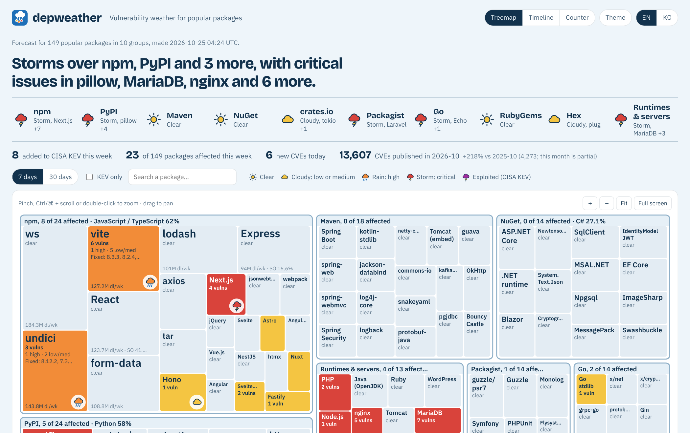

<p align="center"></p>

<h1 align="center">depweather</h1>

<p align="center">
  Vulnerability weather for popular packages.<br>
  <a href="https://depweather.com"><b>depweather.com</b></a> · updated daily<br><br>
  <b>English</b> | <a href="README.ko.md">한국어</a>
</p>

<p align="center">
  <a href="https://depweather.com"></a>
</p>

Every morning, depweather answers one question: **did any popular package I
probably depend on get a serious vulnerability this week?** It reads like a
weather report, so you can tell in a few seconds.

## What you see

- **A forecast** written from the data, like *"Storms over npm, PyPI and 3 more,
  with critical issues in pillow, MariaDB, nginx and 6 more."*
- **A map of 149 popular packages** in 10 groups: npm, PyPI, Maven, NuGet,
  crates.io, Packagist, Go, RubyGems, Hex, and runtimes & servers such as PHP,
  Node.js and nginx. Bigger tile, more downloads. Zoom in for details.
- **A 30-day timeline** for any package, with the versions that fix each issue.
- English and Korean, light and dark, and it works on a phone.

| Weather | Means |
|---|---|
| ☀️ Clear | No new advisory |
| ☁️ Cloudy | Low or medium |
| 🌧️ Rain | High |
| ⛈️ Storm | Critical |
| Magenta storm | Actively exploited (on the CISA KEV list) |

## Why

The number of published CVEs grew about 2.5x in a year, and CVSS scores alone
no longer tell you what to look at first. depweather shows packages rather
than CVE IDs, and marks what is known to be exploited.

It does not scan your code. For that, use Dependabot, `npm audit`,
`pip-audit`, `govulncheck` or `osv-scanner`.

## How it works

A GitHub Actions job runs once a day. It pulls advisories from
[OSV](https://osv.dev), exploited flags from
[CISA KEV](https://www.cisa.gov/known-exploited-vulnerabilities-catalog),
exploit probabilities from [FIRST EPSS](https://www.first.org/epss/) and CVE
counts from [NVD](https://nvd.nist.gov), and writes them into one JSON file.
A single HTML page draws it. No server and no login; Google Analytics counts visits.

Details (colors, severity rules, how packages are picked, data licenses):
**[docs/how-it-works.md](docs/how-it-works.md)**

## Missing a package?

The list lives in [`collect/stacks.yml`](collect/stacks.yml). It holds widely
used packages only, picked from the Stack Overflow 2026 survey and registry
download rankings. Suggestions are welcome as issues or pull requests.

## Run it yourself

```sh
pip install -r collect/requirements.txt
python collect/collect.py      # writes data/latest.json (about 5 minutes)
python -m http.server          # open http://localhost:8000
```

## Credits and license

Data: OSV.dev (including the GitHub Advisory Database, CC-BY 4.0, and the
Bitnami Vulnerability Database, Apache-2.0), CISA KEV, FIRST EPSS and NVD.
This product uses the NVD API but is not endorsed or certified by the NVD.

Code: [MIT](LICENSE).
